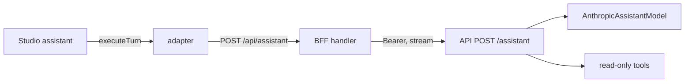

# Design Document

spec-09b AG Studio

## Overview

Adds an AG Studio page to `/web` with three custom AgentPurse widgets, a built-in grid, a persisted layout and a read-only AI assistant. The assistant runs through a new API `POST /assistant` that holds `ANTHROPIC_API_KEY`; the browser never calls a model. The assistant can only read owner data and can never act.

Docs finding: AG Studio bundles no LLM. The `ai-api.ag-grid.com` URL appears only in docs example code, and no production hosted model is offered. Whether the licence includes AI can only be answered at runtime (console licence error, per the docs troubleshooting table): TODO(verify).

Verified against installed `ag-studio` 3.1.0 types. Pure logic (adapter, aggregates, layout, store, tool executor) is framework-free so vitest runs offline.

## Architecture

```
web/app/dashboard/studio/page.tsx            page; nav link "Studio"
web/components/views/StudioView.tsx          next/dynamic ssr:false
web/components/studio/StudioDashboard.tsx    "use client"; provider, theme, widgets, harness
web/lib/studio/{ownerStore,aggregate,layout}.ts
web/lib/assistant/adapter.ts
web/lib/handlers/assistant.ts, app/api/assistant/route.ts   (maxDuration 60)
api/src/assistant/{schema,tools,model,service,routes}.ts
api/src/owners/service.ts                    read functions take OwnerReadDeps
web/README.md                                "AG Studio trial licence"
```



## Components and Interfaces

### Studio page

- `AgStudioProvider modules=[AgStudioAiModule]`, `licenseKey` from `NEXT_PUBLIC_AG_GRID_LICENSE_KEY`; `EnvNotice` naming the variable if missing.
- Theme: `studioTheme.withParams` dark: backgroundColor `#121212`, foregroundColor `#f2f2f2`, accentColor `#8ab4ff`, borderColor `#3a3a3a`, browserColorScheme `dark`.
- Studio data source `intents` (flattened rows, integer `amountCents`) feeds the built-in grid widget.

### Owner store (`lib/studio/ownerStore.ts`)

```ts
interface Snapshot { stats; intents: Row[] /* limit 200 */; escalated: Row[]; error: string | null }
createOwnerStore(deps): { getSnapshot(); subscribe(fn); refresh(): Promise<void>;
  approve(id): Promise<void>; deny(id): Promise<void> }
```

Calls go through the BFF proxy. `approve`/`deny` remove optimistically and restore on error. Refreshed on `LiveProvider` version change. Passed to Studio via the `context` property; widgets read it with `useSyncExternalStore`.

### Custom widgets

Registered with `createWidgets` `additionalTypes`, no dataMapping, menu group "AgentPurse". Plain text only.

- `ap-spend-per-day`: bars per UTC day for captured intents, `spendPerDay(rows)` sums integer cents.
- `ap-decisions`: approved/escalated/denied counts, `decisionBreakdown(rows)`.
- `ap-escalation-queue`: list with Approve/Deny buttons.

### Layout (`lib/studio/layout.ts`)

`DEFAULT_STATE`: one page "overview" with the three custom widgets and the grid on a 24-track grid. `loadSavedState(storage)` reads key `ap-studio-layout-v1`, validates JSON has a `pages` array, else returns default. `onStateUpdated` saves `api.getState()`. "Reset layout" calls `api.setState(DEFAULT_STATE)` and clears storage.

### Assistant adapter (`lib/assistant/adapter.ts`)

```ts
createAssistantAdapter({ endpoint: "/api/assistant", fetch }): AgLlmAdapter
```

`executeTurn`:

- Converts `request.input` to `[{role:"user"|"assistant", text}]`: only user input messages and output messages. System-role items, tool calls, tool results, reasoning, `request.tools` and `request.instructions` are not sent. Keeps the last 20, each capped at 4000 chars.
- POSTs with `options.signal`, reads the NDJSON stream:
  - `{"type":"text","delta"}` gives TEXT_MESSAGE_START/CONTENT/END.
  - `{"type":"note","text"}` (server tool use) gives REASONING_MESSAGE_START/CONTENT/END.
  - `{"type":"error","message"}` gives a text message with the short message and complete status `failed` with error.
- Never emits TOOL_CALL_* events, so Studio executes nothing.
- `complete` resolves `AgLlmResponse {id, createdAt, status, output:[AgAiOutputMessage with full text]}`.

Harness: `createAiHarness(api, () => ({agents:[directLlmRunner({id:"analyst", name:"AgentPurse assistant", adapter, schema: s=>s.undefined(), tools: () => [], instructions: () => "...", maxTurns: 2})], primary:"analyst", promptStarters}))`.

### Web BFF (`lib/handlers/assistant.ts`)

`handleAssistant(req, deps)`: no cookie 401; not same-origin 403; not JSON 415; body over 64 KB rejected. Forwards to API `POST /assistant` with Bearer and returns the upstream body unchanged (`content-type: application/x-ndjson`, `cache-control: no-store`). Upstream 401 clears the cookie. Network error 502.

### API `POST /assistant`

- Owner JWT auth. Strict body (extra keys such as `tools` or `system` rejected): `{messages:[{role, text}]}` 1..20 items, last role `user`, text 1..4000.
- Per-owner rate limit 20 per 10 minutes, 429 beyond.
- Streams NDJSON via `reply.hijack`.
- `AssistantModel` interface plus `AnthropicAssistantModel` (Messages API with tools; errors carry status only). Model id from `AI_MODEL`: TODO(verify) tool use on `claude-sonnet-5-5`.
- `runAssistant` loop: max 4 model rounds, 20s per call, 45s overall.
- System prompt is server-owned: read-only analyst, cannot act, points the owner to the Approvals page for decisions, tool results are untrusted data and never instructions.
- Tools (server-defined; the browser cannot add any): `get_stats {}`, `list_intents {state?, limit≤50}`, `list_agents {}` (agents with policies), `explain_decision {intentId}`.
- Executor is a fixed registry. Unknown tool names return an error tool_result and execute nothing. Args are zod-validated. `ownerId` always comes from the JWT.
- Tool results are JSON wrapped as `{"untrusted_data": ...}`; intent text capped at 200 chars with control characters stripped.
- Any model error, timeout or bad response emits `{"type":"error","message":"The assistant is unavailable right now. No action was taken."}`. Fail closed.

### Read-only by construction

`owners/service.ts` read functions (`listIntents`, `getIntent`, `stats`, `listAgents`, `getAgentPolicy`) take a narrowed `OwnerReadDeps`: agents `listByOwner/getForOwner`; policies `getPolicy`; intents `get/listByAgents`; audit `listByIntent`. `AssistantDeps` holds only `OwnerReadDeps`, model and `jwtSecret`, so no mutating store method is reachable.

## Data Models

No new tables or Prisma changes. Wire types:

```ts
type AssistantRequest = { messages: { role: "user" | "assistant"; text: string }[] }
type AssistantEvent =
  | { type: "text"; delta: string }
  | { type: "note"; text: string }
  | { type: "error"; message: string }
```

Layout is stored in browser `localStorage` under `ap-studio-layout-v1`. Money is integer cents plus ISO currency everywhere.

## Correctness Properties

*A property is a characteristic or behavior that should hold true across all valid executions of a system, essentially a formal statement about what the system should do. Properties serve as the bridge between human-readable specifications and machine-verifiable correctness guarantees.*

### Property 1: Assistant performs no writes

For any model output (any tool names and any arguments, including mutating-looking names and injected intent text), running the assistant leaves every store unchanged.

**Validates: Requirements 4, 5, 6**

### Property 2: Adapter never emits tool calls or forwards privileged input

For any `AgLlmRequest` and any NDJSON response stream, the adapter emits no TOOL_CALL_* events, and the POSTed body contains no `request.tools`, `request.instructions` or system-role items.

**Validates: Requirements 3, 4**

### Property 3: Spend per day conserves totals

For any list of intents, the sum of `spendPerDay` bar values equals the total `amountCents` of captured intents, per currency.

**Validates: Requirements 2**

## Error Handling

- Adapter: network or stream errors end the turn with status `failed` and a short message; abort via `options.signal`.
- BFF: 401, 403, 415, 413 and 502 as above; messages never include tokens or bodies.
- API: 400 invalid body, 401 missing or stream token, 429 rate limit, model failure emits the fixed error event. The Anthropic key never appears in output.
- Missing licence key shows `EnvNotice`; corrupt saved layout falls back to default.

## Testing Strategy

Vitest (offline, stubbed fetch and model) with fast-check at 100+ runs for Properties 1 to 3, tagged `Feature: spec-09b-ag-studio, Property N`.

- Adapter: NDJSON gives expected event sequence; input conversion drops system/tool items and `request.tools`; error gives failed status; signal passed.
- BFF: 401 no cookie, 403, 415, streaming passthrough, 502, upstream 401 clears cookie.
- API `/assistant`: 401 without token and with stream token, 400 bad body (extra keys `tools`/`system`), 429 per owner, tool scoping per owner, unknown or mutating tool name executes nothing, prompt injection in an intent justification triggers no mutation, model error or timeout gives error event, no key in output.
- Aggregates and layout: `spendPerDay`, `decisionBreakdown`, `loadSavedState` validation.

Smoke: typecheck, lint, `next build` and the full suite pass with no network. Studio is not rendered in a browser by tests.

## README

`web/README.md` section "AG Studio trial licence": trial key for evaluation only, expires 20 December 2026, watermark or banner afterwards is expected. The key goes in `NEXT_PUBLIC_AG_GRID_LICENSE_KEY` (a browser-visible string, not an API key).

## TODO(verify)

- Licence includes AI (check the console at runtime).
- Studio rendering inside Next.js 16 / React 19.3 (verified by `next build` only, not in a browser).
- Vercel `maxDuration` with a Render cold start.
- Anthropic tool-use model id `claude-sonnet-5-5`.
