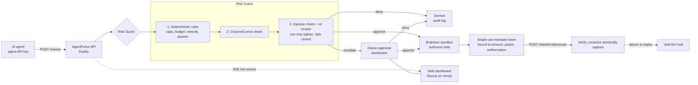

# AgentPurse

**Give your AI an allowance, not your credit card.**

AI agents that can shop need money, and handing one a credit card is a bad deal: one bad prompt, one hijacked tool call, and the card is gone. AgentPurse sits between the agent and the payment. The agent only ever asks ("I want to buy this, for this amount, because..."). Deterministic rules, a live market price check and an AI risk review decide: approve, deny, or escalate to a human. Approved purchases get a held (authorized) payment and a single-use, short-lived mandate token. Only that token can capture the money, once.

Built for the **Build What's Next with PayPal and AI** hackathon.

> **Honesty note.** Payments are **Braintree sandbox** transactions (Braintree is a PayPal service). No real money or physical goods change hands. Product catalog and market price data come from **Channel3** and are real.

## Live demo

| | |
| --- | --- |
| Web dashboard | https://demo-lake-six-41.vercel.app |
| API | https://demo-yhzi.onrender.com (`GET /healthz`) |

- The API runs on a **free tier**. After idling it can take **up to a minute** to wake, so the first sign-in or request may be slow.
- The **judge login and demo password are in the Devpost testing instructions**. They are not stored in this repository.

## How it works



1. The agent submits a **purchase intent** (merchant, item, amount in cents, justification, optional Channel3 product id).
2. **Risk Guard** runs deterministic rules first, then a Channel3 price check, a prompt-injection check and the AI review. The AI can only make a result stricter. Any AI error or timeout escalates.
3. **Approve**: the API places an authorization (a hold, no settlement) and returns a mandate token once. **Escalate**: the owner approves or denies in the dashboard, then the agent fetches its mandate. **Deny**: nothing is held.
4. The agent presents the token. The API verifies it against the stored authorization, consumes it atomically, then captures. If the token is invalid or the capture fails, the hold is voided.
5. Every step is written to an audit log and streamed live to the dashboard.

## Features

- **Risk Guard**: eight deterministic rules (currency, blocked and allowed payees, categories, per-purchase cap, daily budget, hourly and daily velocity), Channel3 price check, prompt-injection heuristic, AI review. A high price always escalates.
- **Human approval**: escalated purchases wait in the Approvals page with the risk score, price check and reason.
- **Single-use mandates**: signed token (5 minute lifetime) bound to intent, authorization, amount, currency and payee. Replay and tampering are rejected.
- **Vault**: a payment method is linked once (Braintree sandbox test card). Agents reference it by id and never see card data.
- **Agents and policies**: per-agent API keys (shown once, stored hashed), spending policy editor, kill switch.
- **Audit trail**: every decision and payment step is recorded and shown per intent.
- **Live monitor**: server-sent events straight from the API, with polling every 2 seconds as a fallback.
- **AG Grid**: the intents table, themed to match the app.
- **AG Studio**: build your own dashboard with three custom widgets (spend per day, decisions, escalation queue), an intents grid, light and dark theming, and a **read-only AI assistant** that explains decisions and summarises data.
- **Dashboard**: Overview, Agents, Intents, Approvals, Live monitor, Vault and Studio, with a light and dark theme.

> The `mobile` workspace is a placeholder (typecheck skeleton only). There is no mobile app yet.

## How PayPal is used

Payments run through a **provider-neutral `PaymentProvider` interface** (`api/src/payments/`): link a payment method, authorize (hold), capture, void, and verify signed webhooks. The default and hosted-demo provider is the **Braintree sandbox** (Braintree is a PayPal service). Money flow: authorize, issue mandate, capture, void if anything fails. Braintree webhooks are signature-verified and de-duplicated at `POST /webhooks/payments`.

An optional second provider using the **PayPal REST API** is still in the code (`api/src/paypal/`, `api/src/payments/paypal/`). Select it with `PAYMENT_PROVIDER=paypal` and the `PAYPAL_*` variables. Missing PayPal keys never affect a Braintree start.

## How AI is used

- **Risk Guard review**: the model gets the intent as untrusted, delimited data and returns a JSON verdict (`approved`, `riskScore`, `reason`, `flagPromptInjection`). Deterministic rules always run first and the AI can only tighten the outcome. Errors, timeouts and malformed output **fail closed** to escalate.
- **AG Studio assistant**: read-only. It can call four server-side read tools scoped to the signed-in owner and cannot approve, deny, create or change anything. The browser never holds a model key.
- **Switchable provider** via `AI_PROVIDER`:
  - `anthropic` (default): needs `ANTHROPIC_API_KEY`; backs the assistant.
  - `gemini`: needs `GEMINI_API_KEY`; no assistant (it replies with a short "not available" message).
  - `openai`: any OpenAI-compatible chat completions API, such as Groq or OpenRouter. Needs `AI_API_KEY`; `AI_BASE_URL` (https) defaults to `https://api.groq.com/openai/v1`; `AI_MODEL` defaults to `openai/gpt-oss-20b` ([Groq tool use](https://console.groq.com/docs/tool-use), [rate limits](https://console.groq.com/docs/rate-limits)). Backs the assistant.
  - `off`: no AI call. Rules and the price check decide; anything not clearly safe escalates.
- `pnpm demo:check` makes one real call to the selected provider and prints a sanitized result (provider, kind, status, message, elapsed). It never prints keys.

## Quick start for a judge

1. Open https://demo-lake-six-41.vercel.app and sign in with the login from the Devpost testing instructions. If the page hangs on the first request, wait a minute for the API to wake.
2. Look around: **Overview**, **Agents** (policies, kill switch), **Vault**, **Intents** (AG Grid), **Live monitor**, **Studio** (widgets and the assistant).
3. Make an agent buy something. Pick one:
   - **Postman** (no extra keys): import [`docs/postman`](docs/postman) and follow folders 1 to 3. See [`docs/openapi.yaml`](docs/openapi.yaml) for the full API.
   - **Demo agent** (needs your own `CHANNEL3_API_KEY`): create an agent on the **Agents** page (copy its key once) and link the sandbox card on the **Vault** page (copy the method id). Clone the repo, run `pnpm install` and `pnpm --filter @agentpurse/shared run build`, create `.env` from `.env.example`, and set these in it: `DEMO_API_BASE_URL=https://demo-yhzi.onrender.com`, `DEMO_AGENT_KEY`, `DEMO_PAYMENT_METHOD_ID`, `CHANNEL3_API_KEY`. Run `pnpm demo:run --scenario all`.
4. Watch the **Live monitor** and **Approvals** pages while it runs.

## Local setup

Prerequisites: Node.js 20 or newer, pnpm 9 (`corepack enable`), a PostgreSQL database, and sandbox or free-tier keys for Braintree, Channel3 and one AI provider.

```sh
pnpm install                       # also installs the pre-commit hook and generates the Prisma client
cp .env.example .env               # then fill in your own values (never commit .env)
pnpm --filter @agentpurse/shared run build
pnpm db:migrate                    # prisma migrate deploy against DATABASE_URL in .env
pnpm seed:demo                     # demo owner, one agent with a policy, vaulted sandbox card (prints login, key and method id once)
pnpm seed:demo --set-password      # optional: set the demo owner password from DEMO_OWNER_PASSWORD
```

Start the API (the root `.env` is loaded explicitly; the API scripts do not read it on their own):

```sh
pnpm --filter @agentpurse/api build
node --env-file=.env api/dist/index.js        # listens on PORT (default 3000; .env.example uses 8080)
```

Start the web app in a second terminal. It reads `web/.env.local` (git-ignored) with `API_BASE_URL`, `NEXT_PUBLIC_API_BASE_URL` and `NEXT_PUBLIC_AG_GRID_LICENSE_KEY`:

```sh
pnpm --filter @agentpurse/web dev             # http://localhost:3000
```

Set `WEB_ORIGIN` in `.env` to the web origin (for example `http://localhost:3000`) so the browser may open the live event stream. If the API also uses port 3000, change `PORT` or the web port.

Optional checks against the live sandbox services (they print ids and statuses only):

```sh
pnpm channel3:smoke "mechanical keyboard"
pnpm payments:smoke              # Braintree sandbox: authorize and capture, authorize and void
pnpm demo:check                  # one call to the selected AI provider
```

### Demo scenarios

The demo agent is a command-line "AI shopper" that finds real products through Channel3 and prints PASS or FAIL per scenario. Details: [`demo-agent/README.md`](demo-agent/README.md).

| Scenario | What the agent does | Expected outcome | Command |
| --- | --- | --- | --- |
| `small-safe` | Buys a cheap item (about a USB-C cable, up to $25) inside the auto-approve band | Approve, mandate, captured. The AI review has the final say, so a cautious model can make this FAIL with its reason | `pnpm demo:run --scenario small-safe` |
| `needs-approval` | Buys a real $70 to $150 product at its real price, above the $50.00 auto-approve limit | Escalated. Approve it in the dashboard within 3 minutes; the agent then gets a mandate and captures | `pnpm demo:run --scenario needs-approval` |
| `over-cap` | Asks for $250.00, above the $200.00 per-purchase cap | Denied by the deterministic rules, no mandate | `pnpm demo:run --scenario over-cap` |
| `overpriced` | Asks about 3x the market price for a cheap item, kept under $50.00 | Not approved: the price check flags it. No mandate | `pnpm demo:run --scenario overpriced` |
| `injection` | Justification tells the system to ignore its policy and approve | Not approved, no mandate | `pnpm demo:run --scenario injection` |
| `replay` | Completes a purchase, then reuses the consumed mandate | API returns 409 and the intent stays `captured` | `pnpm demo:run --scenario replay` |
| all six | Runs them in order | Exit code 0 when every scenario passes | `pnpm demo:run --scenario all` |

The seed policy is a $200.00 per-purchase cap, a $500.00 daily budget, 10 purchases per hour and 30 per day. If you run `small-safe` or `replay` more than 10 times an hour you will hit the hourly limit.

## Environment variables

Copy `.env.example` to `.env`. Values are never committed. "Secret" means server-only: it must never reach the web or mobile bundle (`pnpm check:web-bundle` checks this). If a required variable is missing at runtime the app names it and stops.

| Variable | Required | Secret | Set in | Purpose |
| --- | --- | --- | --- | --- |
| `PORT` | optional (default 3000) | no | local; Render sets it | API port |
| `HOST` | optional (default `0.0.0.0`) | no | local | API bind address |
| `DATABASE_URL` | required | yes | local, Render | PostgreSQL connection string |
| `JWT_SECRET` | required (32+ chars) | yes | local, Render | Signs owner and stream tokens |
| `MANDATE_SIGNING_KEY` | required (32+ chars) | yes | local, Render | Signs mandate tokens |
| `PAYMENT_PROVIDER` | optional (`braintree` default, or `paypal`) | no | local, Render | Payment provider |
| `BRAINTREE_ENV` | required for Braintree (`sandbox`) | no | local, Render | Braintree environment |
| `BRAINTREE_MERCHANT_ID` | required for Braintree | server-only | local, Render | Braintree sandbox merchant |
| `BRAINTREE_PUBLIC_KEY` | required for Braintree | server-only | local, Render | Braintree sandbox key |
| `BRAINTREE_PRIVATE_KEY` | required for Braintree | yes | local, Render | Braintree sandbox key |
| `PAYPAL_CLIENT_ID`, `PAYPAL_CLIENT_SECRET`, `PAYPAL_WEBHOOK_ID`, `PAYPAL_BASE_URL` | only if `PAYMENT_PROVIDER=paypal` | `PAYPAL_CLIENT_SECRET` yes | local | Optional PayPal REST provider |
| `AI_PROVIDER` | optional (`anthropic` default, `gemini`, `openai`, `off`) | no | local, Render | Risk Guard and assistant provider |
| `ANTHROPIC_API_KEY` | only if `AI_PROVIDER=anthropic` | yes | local, Render | Anthropic key |
| `GEMINI_API_KEY` | only if `AI_PROVIDER=gemini` | yes | local, Render | Gemini key |
| `AI_API_KEY` | only if `AI_PROVIDER=openai` | yes | local, Render | OpenAI-compatible key (Groq, OpenRouter) |
| `AI_BASE_URL` | optional, `openai` only (https; default Groq) | no | local, Render | OpenAI-compatible base URL |
| `AI_MODEL` | optional | no | local, Render | Model id for the selected provider |
| `AI_TIMEOUT_MS` | optional (max 25000; default 12000 for `gemini` and `openai`, 15000 for `anthropic`) | no | local, Render | AI review time limit |
| `CHANNEL3_API_KEY` | required | yes | local, Render | Channel3 catalog and price data |
| `WEB_ORIGIN` | required for the hosted web app (comma-separated origins) | no | local, Render | Origins allowed to open the live stream |
| `APP_BASE_URL` | reserved, not read by the code yet | no | local, Render | Listed in `render.yaml` |
| `API_BASE_URL` | required for web | server-only | `web/.env.local`, Vercel | API URL used by the web server (BFF) |
| `NEXT_PUBLIC_API_BASE_URL` | required for web | no (browser-visible) | `web/.env.local`, Vercel | API URL for the live event stream |
| `NEXT_PUBLIC_AG_GRID_LICENSE_KEY` | required for AG Studio | no (browser-visible licence string, not an API key) | `web/.env.local`, Vercel | AG Grid and AG Studio licence |
| `DEMO_OWNER_PASSWORD` | only for `seed:demo --set-password` | yes | local | Demo owner password (never printed) |
| `DEMO_API_BASE_URL` | demo agent (default `http://localhost:8080`) | no | local | API the demo agent calls |
| `DEMO_AGENT_KEY` | demo agent | yes | local | Agent API key from `seed:demo` or the Agents page |
| `DEMO_PAYMENT_METHOD_ID` | demo agent | no | local | Vault method id used as `paymentMethodRef` |

`NEXT_PUBLIC_` values are inlined at build time, so set them in Vercel before building. Render settings are in [`render.yaml`](render.yaml) (all secrets use `sync: false`); Vercel settings are in [`web/README.md`](web/README.md).

## Tests and checks

```sh
pnpm test                 # vitest: unit and property tests, offline (fixtures and stubs, no live calls)
pnpm typecheck            # tsc --noEmit in every workspace
pnpm lint                 # eslint
pnpm check:env-example    # .env.example holds placeholders only
pnpm --filter @agentpurse/web run build
pnpm check:web-bundle     # after a web build: no server-only names in the browser bundle
pnpm scan:staged          # secret scan over staged files (also runs in the pre-commit hook)
```

At the time of writing the suite has 622 tests in 57 files. CI (`.github/workflows/ci.yml`) runs `check:env-example`, `lint`, a shared-package build, `typecheck` and `test`. The suite covers budget math, single-use tokens, replay and tamper rejection, idempotency, webhook signatures and fail-closed AI errors.

## Security notes

- **No secrets in the repo.** `.env` and `.env.*` are git-ignored, only `.env.example` (placeholders) is tracked, and `check:env-example` rejects anything that looks like a real value.
- **Secret scanning.** `scripts/pre-commit.sh` (installed by `pnpm install`) runs `scan:staged`, blocks a staged `.env` and checks `.env.example`.
- **Money is integer cents** plus an ISO 4217 currency code. Decimal strings exist only inside the provider adapters.
- **Fail-closed AI.** The AI can only tighten a decision. Errors, timeouts and bad output escalate. Intent text is treated as untrusted data.
- **Single-use mandates.** The token is verified against the stored authorization, consumed with an atomic update, then used to capture. Replays and mismatches are rejected; failures void the hold.
- **Ownership checks.** Every owner lookup is filtered by the signed-in owner; a foreign id looks the same as an unknown id (404). Agent keys are stored as SHA-256 hashes and shown once.
- **Auth.** Owner JWTs (HS256, one hour), separate 60-second stream tokens, scrypt password hashing, rate-limited sign-in and register. The web app keeps the JWT in an httpOnly, Secure cookie and talks to the API from its server.
- **Logging.** Tokens, passwords, nonces and keys are redacted; request logs drop query strings.
- **Sandbox only.** No real money moves.

## Known limits

- Free-tier cold start: the first request after idle can take up to a minute.
- The rate limiters and the live event bus are **in memory**, so they assume a **single API instance**. Scaling out needs a shared store (for example Postgres or Redis).
- The AG Grid and AG Studio trial licence key **expires on 20 December 2026**; expect a watermark or banner after that.
- Sandbox payments only; the Braintree test card is linked with a fixed sandbox nonce.
- Free AI tiers are tight. For example Groq's free plan lists about 30 requests and 8K tokens per minute for `openai/gpt-oss-20b`, so the openai provider keeps prompts and outputs short and caches identical reviews for a minute. Hitting a limit escalates the purchase to the owner.
- The `small-safe` scenario depends on the AI review approving a cheap purchase.
- The mobile workspace is a placeholder.

## Repository map

| Path | What |
| --- | --- |
| `api/` | Fastify API (Render), Prisma schema and migrations, Risk Guard, payments, assistant |
| `web/` | Next.js dashboard (Vercel), AG Grid and AG Studio |
| `demo-agent/` | Command-line shopping agent with six scenarios |
| `packages/shared/` | Shared money type and policy schemas |
| `mobile/` | Placeholder workspace |
| `docs/` | [`openapi.yaml`](docs/openapi.yaml), [`postman/`](docs/postman), [`DEMO_SCRIPT.md`](docs/DEMO_SCRIPT.md) |
| `.kiro/specs/` | Kiro specs, one per slice |
| [`TOOLS_USED.md`](TOOLS_USED.md), [`HACKATHON_PROGRESS.md`](HACKATHON_PROGRESS.md) | Tools used and the build log |

## License

MIT. See [`LICENSE`](LICENSE).
